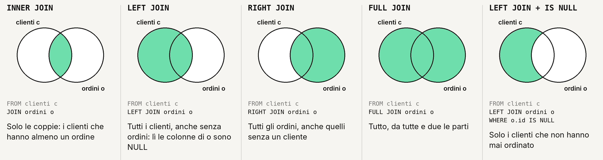

# Il bigino di SQL

Tutto quello che serve oggi, in una pagina. Gli esempi usano il database `negozio`: provateli in psql, uno alla volta.

## Entrare

Dalla cartella `giorno-04`:

```bash
createdb negozio                          # crea un database vuoto (una volta sola)
psql -d negozio -f negozio/negozio.sql    # esegue i comandi del file: tabelle e dati
psql -d negozio                           # entra: il prompt diventa negozio=#
```

Se non si connette, PostgreSQL è spento. Su WSL: `sudo service postgresql start`. Su Mac: `brew services start postgresql@16`.

## Dentro psql

| Comando | Cosa fa |
|---|---|
| `\dt` | Elenca le tabelle |
| `\d clienti` | Le colonne di una tabella, le chiavi e i collegamenti |
| `\x auto` | Va a capo quando le righe sono troppo lunghe |
| `↑` | Richiama il comando precedente |
| `\q` | Esce |

Con la barra è psql. Tutto il resto è SQL, e **finisce con il punto e virgola**. Se il prompt diventa `negozio-#`, psql sta aspettando il `;`.

## Le due tabelle del negozio

```
clienti                         ordini
id  nome  cognome  citta  …     id  cliente_id  data  totale  stato
 1  Anna  Rossi    Milano        1           1  …      …       consegnato
                                             └── punta a clienti.id
```

## Leggere: SELECT

```sql
SELECT * FROM clienti;                         -- tutte le colonne
SELECT nome, cognome FROM clienti;             -- solo queste colonne
SELECT nome, cognome AS famiglia FROM clienti; -- AS: rinomina la colonna nel risultato
SELECT DISTINCT citta FROM clienti;            -- ogni città una volta sola
```

Testo tra **apici singoli**: `'Milano'`. Con le virgolette doppie PostgreSQL cerca una colonna chiamata Milano.

## Filtrare: WHERE

```sql
SELECT nome FROM clienti WHERE citta = 'Milano';
SELECT * FROM ordini WHERE totale >= 100;
SELECT * FROM ordini WHERE stato <> 'annullato';                 -- <> vuol dire diverso
SELECT * FROM ordini WHERE data BETWEEN '2026-01-01' AND '2026-03-31';
SELECT nome, citta FROM clienti WHERE citta IN ('Roma', 'Napoli');
SELECT nome, citta FROM clienti WHERE citta = 'Milano' AND iscritto_il >= '2026-01-01';
```

| Operatore | Esempio |
|---|---|
| `=` `<>` | `stato <> 'annullato'` |
| `>` `<` `>=` `<=` | `totale >= 100` |
| `BETWEEN … AND …` | `data BETWEEN '2026-01-01' AND '2026-03-31'` (estremi compresi) |
| `IN (…)` | `citta IN ('Roma', 'Napoli')` |
| `LIKE` | `cognome LIKE 'R%'` |
| `IS NULL` | `email IS NULL` |
| `AND` `OR` `NOT` | `citta = 'Milano' AND totale > 50` |

## Cercare un pezzo di testo: LIKE

```sql
SELECT nome, cognome FROM clienti WHERE cognome LIKE 'R%';      -- inizia con R
SELECT nome, email FROM clienti WHERE email LIKE '%@example%';  -- contiene @example
SELECT nome FROM clienti WHERE nome ILIKE 'anna';               -- ILIKE: senza badare alle maiuscole
```

`%` vuol dire «qualsiasi cosa, anche niente». `_` vuol dire «un carattere solo».

## NULL: il valore che manca

```sql
SELECT nome FROM clienti WHERE email IS NULL;       -- giusto
SELECT nome FROM clienti WHERE email = NULL;        -- sbagliato: non trova mai niente
```

NULL non è uguale a niente, nemmeno a un altro NULL. Si controlla solo con `IS NULL` e `IS NOT NULL`.

## Ordinare e limitare: ORDER BY e LIMIT

```sql
SELECT nome, iscritto_il FROM clienti ORDER BY iscritto_il;          -- dal più vecchio
SELECT nome, iscritto_il FROM clienti ORDER BY iscritto_il DESC;     -- dal più recente
SELECT * FROM ordini ORDER BY totale DESC LIMIT 3;                   -- i 3 ordini più cari
SELECT nome, cognome FROM clienti ORDER BY cognome, nome;            -- prima per cognome, poi per nome
```

## Collegare le tabelle: JOIN

```sql
SELECT c.nome, c.cognome, o.data, o.totale
FROM ordini o
JOIN clienti c ON c.id = o.cliente_id
ORDER BY o.data;
```

- `ordini o`, `clienti c`: un nome corto per ogni tabella (alias).
- `ON c.id = o.cliente_id`: quali righe vanno insieme. Quasi sempre è «la chiave esterna = l'id».
- `c.nome`: la colonna `nome` della tabella `c`.

### Quali righe tiene ogni JOIN



| Scrivete | Restano |
|---|---|
| `JOIN` (o `INNER JOIN`) | Solo le coppie: i clienti che hanno almeno un ordine |
| `LEFT JOIN` | Tutti i clienti, anche senza ordini. Lì le colonne di `o` sono NULL |
| `RIGHT JOIN` | Tutti gli ordini, anche quelli senza un cliente |
| `FULL JOIN` | Tutto, da tutte e due le parti |
| `LEFT JOIN` + `WHERE o.id IS NULL` | Solo i clienti che non hanno mai ordinato |

«A sinistra» vuol dire la tabella scritta **prima** della JOIN, cioè quella del `FROM`.

```sql
-- chi non ha mai ordinato?
SELECT c.nome, c.cognome
FROM clienti c
LEFT JOIN ordini o ON o.cliente_id = c.id
WHERE o.id IS NULL;
```

Nel giallo vi basta quasi sempre `JOIN`. Più tabelle? Si aggiunge una JOIN per volta:

```sql
FROM a
JOIN b ON b.a_id = a.id
JOIN c ON c.b_id = b.id
```

## Riassumere: COUNT, SUM, AVG, MIN, MAX

```sql
SELECT COUNT(*) FROM ordini;                                       -- quante righe
SELECT SUM(totale), AVG(totale) FROM ordini WHERE stato <> 'annullato';
SELECT MIN(data), MAX(data) FROM ordini;                           -- il primo e l'ultimo
```

## Un numero per ogni gruppo: GROUP BY

```sql
SELECT stato, COUNT(*) AS quanti
FROM ordini
GROUP BY stato;
```

Ogni colonna nel `SELECT` o sta nel `GROUP BY`, o sta dentro una funzione come `COUNT` o `SUM`. Altrimenti: errore.

## Filtrare i gruppi: HAVING

```sql
SELECT c.citta, COUNT(*) AS ordini
FROM ordini o
JOIN clienti c ON c.id = o.cliente_id
WHERE o.stato <> 'annullato'      -- WHERE: scarta le righe, prima dei gruppi
GROUP BY c.citta
HAVING COUNT(*) >= 3;             -- HAVING: scarta i gruppi, dopo
```

## L'ordine giusto

Si **scrive** in quest'ordine, e nessuna parte si può spostare:

```sql
SELECT … FROM … JOIN … ON … WHERE … GROUP BY … HAVING … ORDER BY … LIMIT …;
```

Si **legge** partendo dal `FROM`: da dove vengono i dati → quali righe tengo (`WHERE`) → come le raggruppo → cosa mostro (`SELECT`) → in che ordine.

## Gli errori che vedrete

| Errore | Vuol dire | Si risolve |
|---|---|---|
| Il prompt resta `negozio-#` | Manca il `;` | Scrivete `;` e Invio |
| `column "milano" does not exist` | Testo tra virgolette doppie, o senza apici | `'Milano'`, con gli apici singoli |
| `relation "cliente" does not exist` | Nome della tabella sbagliato | `\dt` e controllate: è `clienti` |
| `column reference "id" is ambiguous` | `id` c'è in tutte e due le tabelle | Dite quale: `c.id` oppure `o.id` |
| `must appear in the GROUP BY clause` | Una colonna nel SELECT non è nel GROUP BY | Aggiungetela al GROUP BY |
| `syntax error at or near "WHERE"` | Parti nell'ordine sbagliato, o una virgola di troppo | Controllate l'ordine qui sopra |
| Nessun risultato con `= NULL` | NULL non si confronta con `=` | `IS NULL` |
| `could not connect to server` | PostgreSQL è spento | `sudo service postgresql start` (WSL) |
