# Il debugger di VS Code, passo per passo

Quando lanciate un programma, Python esegue tutte le righe di fila, velocissimo, e alla fine vi mostra solo il risultato.
**Il debugger è il tasto pausa.** Ferma il programma su una riga che scegliete voi, e da lì potete:

- andare avanti **una riga alla volta**;
- guardare **quanto vale ogni variabile** in quel preciso momento.

È come guardare un film fotogramma per fotogramma: vedete il momento esatto in cui qualcosa va storto.

---

## Parte 1 · Prepararlo (una volta sola)

### 1. VS Code è aperto nel posto giusto?

Avete fatto `code .` dalla cartella della squadra (vedi il [README](README.md)). Controllate due cose:

- **A sinistra, nell'elenco dei file**, vedete `indagine.py`, `dati.py`, `prova-debug`. Se vedete tutto il corso, avete aperto la cartella sbagliata: **File → Open Folder** → `giorno-04/squadra-a` (la vostra lettera).
- **La prima volta che aprite la cartella**, VS Code chiede *«Do you trust the authors of the files in this folder?»*: cliccate **Yes, I trust the authors**. Se avete chiuso la finestra e in alto c'è la fascia **Restricted Mode**, cliccate **Restricted Mode** in basso a sinistra, poi **Trust**. In modalità ristretta il debugger e le estensioni non partono.

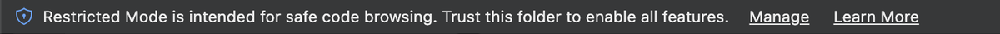

Se la vedete, cliccate qui, in basso a sinistra, poi **Trust**:

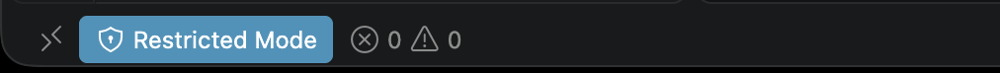

- **Solo per Windows**: in basso a sinistra c'è un riquadro con scritto **`WSL: Ubuntu`**. Se non c'è, VS Code sta guardando Windows e non Ubuntu: chiudetelo, aprite il terminale di Ubuntu, andate nella cartella e scrivete `code .`.

### 2. Le estensioni

Pannello **Extensions** (l'icona con i quattro quadratini, a sinistra), cercate e installate:

- **Python** (di Microsoft)
- **Python Debugger** (di Microsoft): di solito arriva da sola con la prima.

**Su Windows**: se accanto all'estensione c'è un pulsante **Install in WSL: Ubuntu**, cliccatelo. Le estensioni vanno installate *dentro* Ubuntu, non solo su Windows.

### 3. Quale Python usa VS Code

In basso a destra, quando avete aperto un file `.py`, c'è scritta una versione di Python. Deve esserci anche **`.venv`**, per esempio `3.10.12 ('.venv': venv)`.

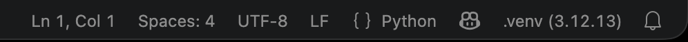

(Sul vostro computer la versione può essere diversa: conta che ci sia scritto `.venv`.)

Se non c'è: cliccate sulla versione (oppure `Ctrl+Shift+P`, su Mac `Cmd+Shift+P`, e scrivete **Python: Select Interpreter**) e scegliete quello con `.venv`.

Perché conta: il debugger usa questo Python. Se è quello sbagliato, non trova pytest.

### 4. Configurare il debugger e i test

VS Code ha bisogno di sapere due cose: **come lanciare** i vostri programmi e **dove cercare** i test. Non si scrive niente a mano: si risponde a due menu, e VS Code scrive le risposte in una cartella nuova, **`.vscode`**, dentro il progetto.

**Il debugger**

1. A sinistra cliccate **Run and Debug** (il triangolo «play» con un insetto).
2. Cliccate il link **create a launch.json file**.

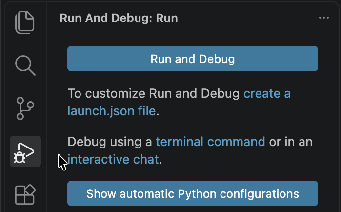

3. Scegliete **Python Debugger**…

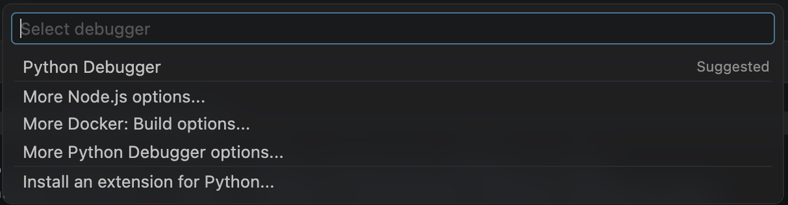

   …poi **Python File**, la prima voce:

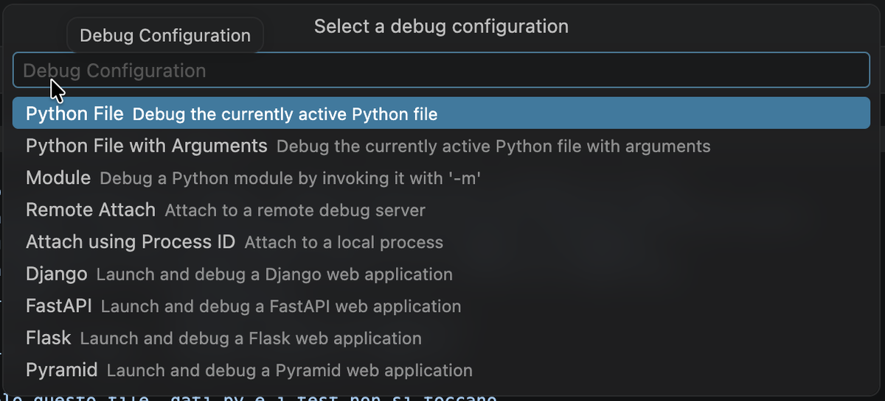


Si apre un file nuovo, `.vscode/launch.json`:

```json
{
    "version": "0.2.0",
    "configurations": [
        {
            "name": "Python Debugger: Current File",
            "type": "debugpy",
            "request": "launch",
            "program": "${file}",
            "console": "integratedTerminal"
        }
    ]
}
```

| Riga | Vuol dire |
|---|---|
| `"name"` | Il nome che vedete nel menu del debugger, in alto |
| `"type": "debugpy"` | Il debugger di Python |
| `"program": "${file}"` | Lancia **il file che avete aperto** in quel momento |
| `"console": "integratedTerminal"` | L'output esce nel terminale di VS Code |

Nel vostro ci sono in più, in alto, tre righe che iniziano con `//`: sono commenti, lasciateli. Se compare un riquadro con scritto **Python Debugger**, è un suggerimento: premete **Esc**, non cliccatelo (aggiungerebbe una seconda configurazione).

Salvate (Cmd+S o Ctrl+S) e chiudetelo: non serve toccarlo.

Così appare appena creato, con il suggerimento da chiudere con **Esc**:

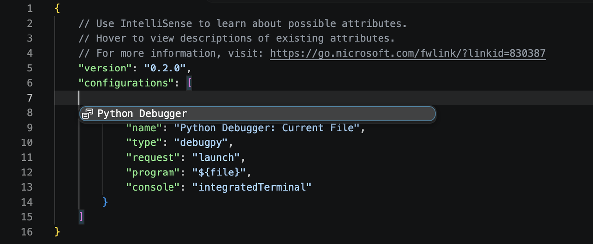


**I test**

1. A sinistra cliccate **Testing** (l'icona della provetta).
2. Cliccate **Configure Python Tests**.

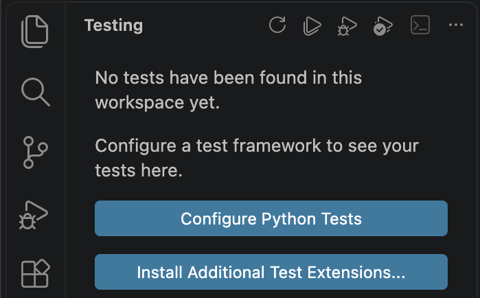

3. Scegliete **pytest** (la seconda voce, non unittest)…

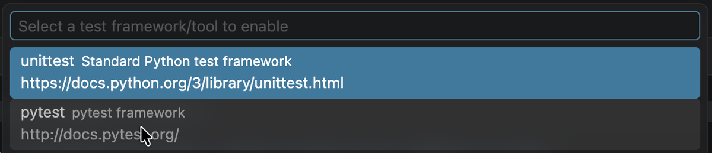

   …poi **. Root directory** (la prima voce, col punto: la cartella principale). **Non** `prova-debug`: lì non ci sono test.

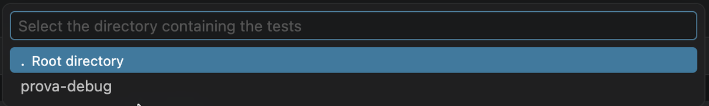


VS Code scrive `.vscode/settings.json` e nel pannello compare una riga **Project: …** (o il nome della cartella): apritela con la freccina e dentro ci sono `test_indagine.py` e i suoi test. Se resta vuota, cliccate la freccia circolare in alto (Refresh Tests).

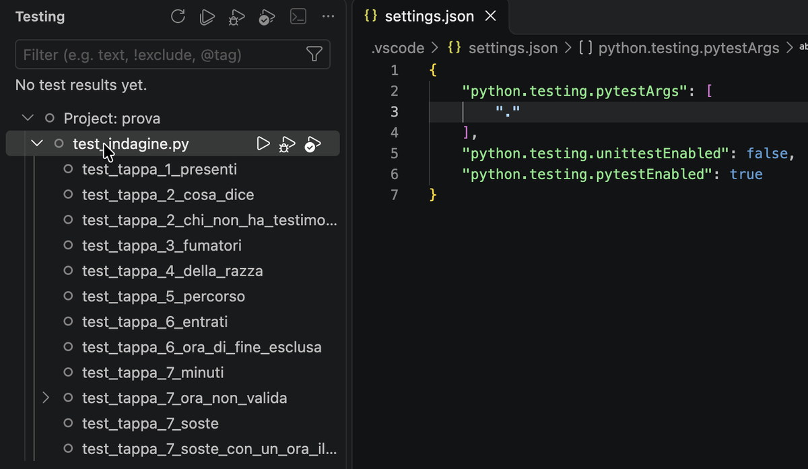

A destra, `settings.json`: in `pytestArgs` deve esserci `"."`.

Cliccate ▶ accanto a `test_indagine.py`. All'inizio dell'indagine sono quasi tutti **rossi**: è giusto, ogni tappa ha il suo errore. Ogni tappa che correggete diventa verde.

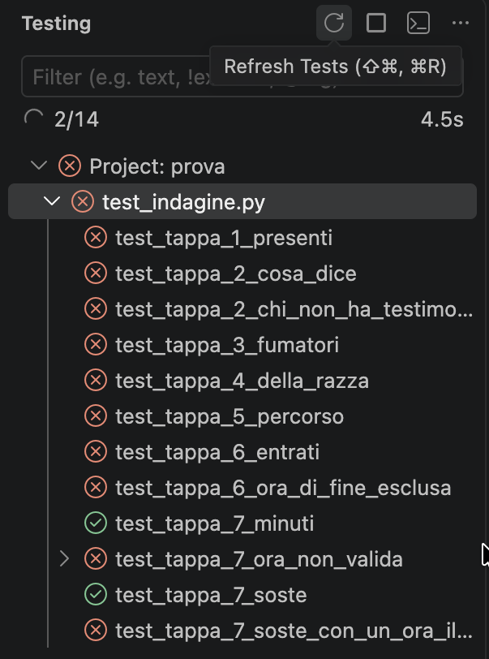


> Il punto davanti a `.vscode` la rende nascosta: nel Finder o in Esplora risorse non si vede, ma VS Code la mostra a sinistra. Si fa **una volta per progetto**: nel progetto finale rifarete gli stessi due passi.

---

## Parte 2 · La prima pausa: `prova-debug/lembas.py`

Il programma dovrebbe dire che le gallette sono 16. Lanciatelo nel terminale: `python prova-debug/lembas.py`. Dice 12. Nessun errore, solo un numero sbagliato. Guardando il codice non si capisce: usiamo il debugger.

### 5. Il breakpoint: dove mettere in pausa

Aprite `lembas.py`. Portate il mouse **a sinistra del numero di riga** di `totale = 0`: compare un pallino rosso chiaro. Cliccate: diventa **rosso pieno**. Quello è il **breakpoint**: lì il programma si fermerà.

Per toglierlo, si clicca di nuovo sul pallino.

### 6. Partire

A sinistra cliccate l'icona **Run and Debug**. In alto, nel menu a tendina accanto al triangolo verde, c'è **Python Debugger: Current File**: cliccate il triangolo verde.

La prossima volta basta **F5**.

Succedono tre cose:

- in alto compare una **barra con dei pulsanti**;
- la riga del breakpoint diventa **gialla**;
- a sinistra compare il pannello **VARIABLES**.

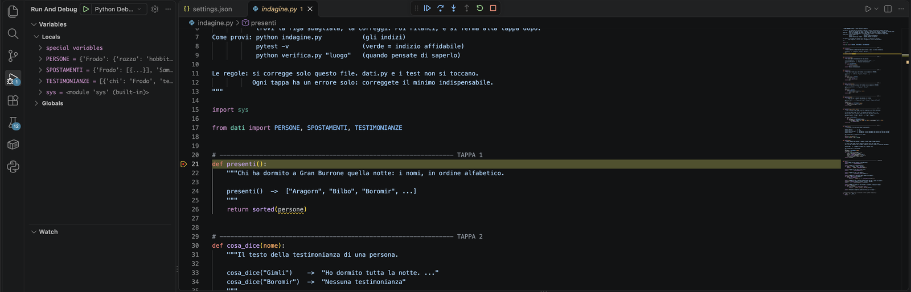

> **La riga gialla NON è ancora stata eseguita.** È la prossima che Python eseguirà. Questo è l'errore di lettura più comune.

### 7. I pulsanti della barra

| Pulsante | Tasto | Cosa fa |
|---|---|---|
| ▶ Continue | F5 | Riparte e corre fino al prossimo breakpoint (o fino alla fine) |
| ↷ Step Over | **F10** | **Esegue la riga gialla e si ferma alla successiva.** È quello che userete il 90% delle volte |
| ↓ Step Into | F11 | Se sulla riga c'è una vostra funzione, entra dentro e si ferma alla sua prima riga |
| ↑ Step Out | Shift+F11 | Finisce la funzione in cui siete ed esce |
| ⟲ Restart | Ctrl+Shift+F5 | Ricomincia da capo |
| ■ Stop | Shift+F5 | Ferma tutto |

**Su Mac** i tasti F5, F10, F11 di solito alzano il volume o la luminosità: tenete premuto **fn** (fn+F10). Oppure cliccate i pulsanti, va benissimo uguale.

### 8. Un giro alla volta

Premete **F10** e, a ogni pressione, guardate il pannello **VARIABLES**:

- `nomi` è la lista dei nomi (cliccate la freccina per aprirla);
- `i` è il numero del giro: 0, 1, 2…;
- `nome` è il nome di quel giro;
- `totale` cresce.

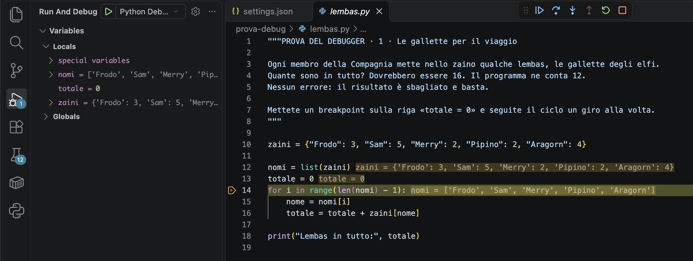

Accanto al codice, in grigio, VS Code scrive i valori delle variabili: a ogni F10 cambiano.

Contate i giri. Quanti nomi ci sono? Quanti giri fa il ciclo? **Chi non viene mai contato?**

Trovato? Fermate il debugger (Shift+F5), correggete e rilanciate. La correzione più semplice è anche il codice più pulito: `for nome in zaini:` scorre già tutte le chiavi, senza `range` e senza `i`.

### 9. Guardare una cosa precisa: WATCH e DEBUG CONSOLE

Sotto VARIABLES ci sono altri due strumenti:

- **WATCH**: cliccate il **+** e scrivete un'espressione, per esempio `zaini[nome]` o `len(nomi)`. VS Code ve la ricalcola a ogni passo.
- **DEBUG CONSOLE** (nel pannello in basso, accanto a TERMINAL): mentre il programma è in pausa potete scrivere codice Python e vedere il risultato. Provate `nomi[-1]` o `list(zaini.items())`.

---

## Parte 3 · Quando il programma si rompe: `prova-debug/gandalf.py`

### 10. Senza breakpoint

Aprite `gandalf.py`, **non mettete breakpoint** e premete F5.

Il programma si ferma da solo **sulla riga dell'errore**, con un riquadro rosso che dice che errore è. Il pannello VARIABLES vi mostra le variabili **nel momento esatto dell'errore**: quanto vale `nome`? Cosa c'è dentro `zaini`?

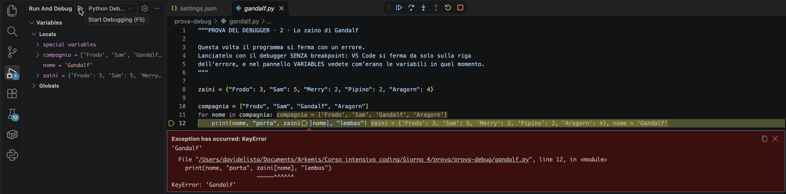

È la differenza tra leggere «KeyError: 'Gandalf'» e vedere con i vostri occhi che nello zaino Gandalf non c'è.

---

## Parte 4 · Il debugger con i test

### 11. Il pannello Testing

Cliccate l'icona **Testing** a sinistra (la provetta). Dovreste vedere `test_indagine.py` e i test dentro. Se non li vedete, rifate la seconda parte del punto 4.

- ▶ accanto a un test: lo esegue.
- **Tasto destro → Debug Test**: lo esegue con il debugger. Si ferma sui vostri breakpoint, anche dentro `indagine.py`.

### 12. Per l'indagine

Aprite `indagine.py` e premete F5: «Current File» lancia proprio il file aperto. Se avete aperto `dati.py` e premete F5, lancia `dati.py` (e non succede niente): controllate sempre quale file è in primo piano.

---

## Se qualcosa non va

| Sintomo | Cosa fare |
|---|---|
| F5 apre un menu che chiede «Select debugger» | Manca `launch.json`: rifate il punto 4 (oppure scegliete **Python Debugger** → **Python File**) |
| Il programma non si ferma sul breakpoint | Il breakpoint è su una riga che non viene mai eseguita, oppure il file in primo piano è un altro |
| In basso a sinistra c'è scritto **Restricted Mode** | Cliccateci, poi **Trust**: senza, debugger ed estensioni restano spenti |
| Il pannello Testing è vuoto | Mancano le impostazioni dei test, o avete scelto la cartella sbagliata: in `.vscode/settings.json`, dentro `python.testing.pytestArgs`, deve esserci `"."` |
| Il pallino del breakpoint è grigio e vuoto | VS Code non riconosce il file come Python: controllate il punto 3 |
| `No module named pytest` | Python sbagliato: punto 3 |
| Su Windows non compare l'opzione Python Debugger | L'estensione è installata su Windows ma non in WSL: punto 2 |
| Su Mac F10 abbassa il volume | **fn+F10**, oppure i pulsanti della barra |

## In una riga

**Breakpoint** (dove fermarsi) → **F5** (parti) → **F10** (una riga) → **VARIABLES** (guarda) → ripeti.
